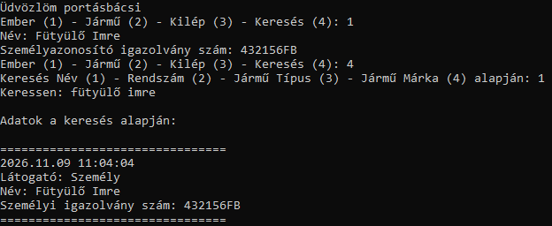

# 🛂 Jani-a-portasbacsi

**Portásbácsi program - C#**  

---

## 🎯 A program célja

A program célja hogy a portán lévő személy logolni tudja hogy ki mikor érkezett és hogy ezeket az adatokat később vissza lehessen keresni.

---

## 📋 Menüpontok

Választási lehetőség | Funkció 

👤 **Ember (1)** | Ember adatainak rögzítése  
🚗 **Jármű (2)** | Jármű adatainak rögzítése   
🚪 **Kilépés (3)** | Kilépés a kérdezés ciklusból  
🔎 **Keresés (4)** | Keresés az állományban  

---

## 👤 (1) Ember

- 📝 Név
- 💳️ Személyi igazolvány száma

---

## 🚗 (2) Jármű

- 🔢 Rendszám
- 🏷️ Márka
- 🚘 Típus
- 🎨 Szín

---

## 🚪 (3) Kilépés

- a hármas gomb megnyomásakor leáll a bekérdezése a látogatóknak

---

## 🔎 (4) Keresés

- a négyes gomb megnyomásakor négy opció lesz a kereséshez:
    - Név alapján keresés
    - Rendszám alapján keresés
    - Jármű típusa alapján keresés
    - Jármű márkája alapján keresés

---

## Példa egy ember érkezésére és keresésére

## 📁 Naplózás

### 📄 `belepes.txt`

A Látogatás logolva lesz a belepes.txt állományba

---

